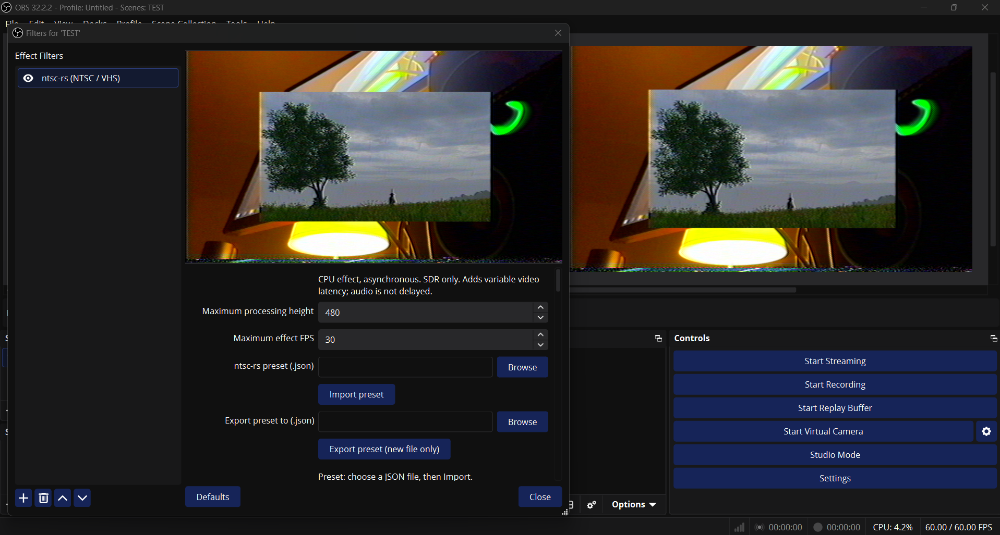

# NTSC-RS for OBS

**Disclaimer:** This is a vibe-coded proof of concept. Compatibility, stability and performance have not been fully tested. Use at your own risk.

A native OBS filter for Windows and Linux powered by **ntsc-rs**, bringing live NTSC/VHS effects to your video sources. Includes ntsc-rs controls, JSON preset import/export, and adjustable processing resolution and frame rate.

Currently CPU-based and SDR-only. Adds video latency without delaying audio. Tested with OBS 32.2.2 on Windows; the Linux build is tested automatically with OBS 32.2.0 on Ubuntu 24.04.

## Downloads

Get them from [Releases](https://github.com/SKBwastaken/NTSC-RS-OBS/releases):

- **Windows:** installer (`Windows-Setup.exe`) or manual ZIP (`Windows.zip`). Unsigned, so Windows may show a warning.
- **Linux system packages:** `Linux.zip` for OBS 32+. Copy the `obs-ntsc-rs` folder into `~/.config/obs-studio/plugins/`. This ZIP is not for Flatpak or Snap.

**Flatpak (experimental):** `Flatpak-x86_64.flatpak` for OBS from Flathub. Install it with
`flatpak install --user ./NTSC-RS-OBS-<version>-Flatpak-x86_64.flatpak`. It is built from
source and tested automatically inside the real OBS Flatpak sandbox (GitHub Actions,
virtual display, software OpenGL). It has not yet been tried in the OBS desktop interface
on a real Linux desktop. See [the Flatpak guide](docs/FLATPAK.md). Do not use the Linux ZIP
with Flatpak. Snap remains unsupported.

Close OBS before installing. In OBS: **Source → Filters → Effect Filters → + → ntsc-rs (NTSC / VHS)**.
Each ZIP includes installation instructions.

## Source and licenses

[Build instructions and limitations](docs/BUILD.md). Plugin integration: GPL-2.0-or-later.
The ntsc-rs core and Rust dependencies retain their own licenses; see [vendor notes](vendor/README.md) and [third-party notices](packaging/THIRD-PARTY.txt).
